# 8th Light themes

Application themes built from the 8th Light brand color palette and the colors used on the 8thlight.com website. Hex values are cross-checked against their RGB values.


## Screenshots

Screenshots were taken with Cousine Nerd Font Mono. The themes do not set a font. The Claude Code and Codex CLI images are generated; see [Agent screenshots](#agent-screenshots).

<details>
<summary><strong>JetBrains IDEs</strong></summary>

|  |  |  |  |
| --- | --- | --- | --- |
| <a href="screenshots/jetbrains/8th-light-black.png"></a><br>Black | <a href="screenshots/jetbrains/8th-light-charcoal.png"></a><br>Charcoal | <a href="screenshots/jetbrains/8th-light-dark-gray.png"></a><br>Dark Gray | <a href="screenshots/jetbrains/8th-light-mid-gray.png"></a><br>Mid Gray |
| <a href="screenshots/jetbrains/8th-light-light-gray.png"></a><br>Light Gray | <a href="screenshots/jetbrains/8th-light-lighter-gray.png"></a><br>Lighter Gray | <a href="screenshots/jetbrains/8th-light-lightest-gray.png"></a><br>Lightest Gray | <a href="screenshots/jetbrains/8th-light-white.png"></a><br>White |

</details>

<details>
<summary><strong>Kitty</strong></summary>

|  |  |  |  |
| --- | --- | --- | --- |
| <a href="screenshots/kitty/8th-light-black.png"></a><br>Black | <a href="screenshots/kitty/8th-light-charcoal.png"></a><br>Charcoal | <a href="screenshots/kitty/8th-light-dark-gray.png"></a><br>Dark Gray | <a href="screenshots/kitty/8th-light-mid-gray.png"></a><br>Mid Gray |
| <a href="screenshots/kitty/8th-light-light-gray.png"></a><br>Light Gray | <a href="screenshots/kitty/8th-light-lighter-gray.png"></a><br>Lighter Gray | <a href="screenshots/kitty/8th-light-lightest-gray.png"></a><br>Lightest Gray | <a href="screenshots/kitty/8th-light-white.png"></a><br>White |

</details>

<details>
<summary><strong>Neovim and Neovide</strong></summary>

|  |  |  |  |
| --- | --- | --- | --- |
| <a href="screenshots/nvim/8th-light-black.png"></a><br>Black | <a href="screenshots/nvim/8th-light-charcoal.png"></a><br>Charcoal | <a href="screenshots/nvim/8th-light-dark-gray.png"></a><br>Dark Gray | <a href="screenshots/nvim/8th-light-mid-gray.png"></a><br>Mid Gray |
| <a href="screenshots/nvim/8th-light-light-gray.png"></a><br>Light Gray | <a href="screenshots/nvim/8th-light-lighter-gray.png"></a><br>Lighter Gray | <a href="screenshots/nvim/8th-light-lightest-gray.png"></a><br>Lightest Gray | <a href="screenshots/nvim/8th-light-white.png"></a><br>White |

</details>

<details>
<summary><strong>Claude Code</strong></summary>

|  |  |  |  |
| --- | --- | --- | --- |
| <a href="screenshots/claude/8th-light-black.png">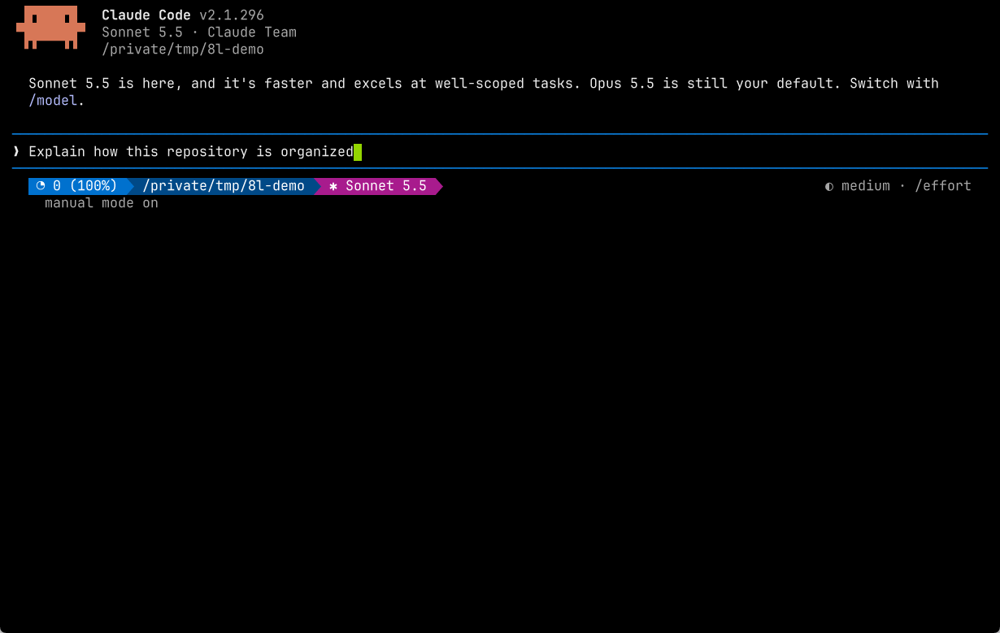</a><br>Black | <a href="screenshots/claude/8th-light-charcoal.png">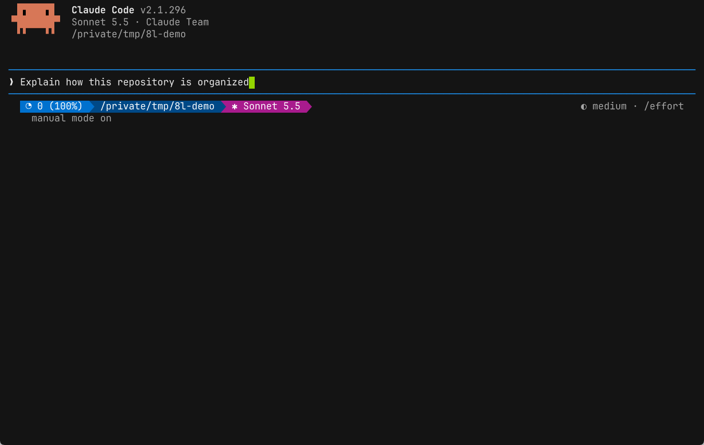</a><br>Charcoal | <a href="screenshots/claude/8th-light-dark-gray.png">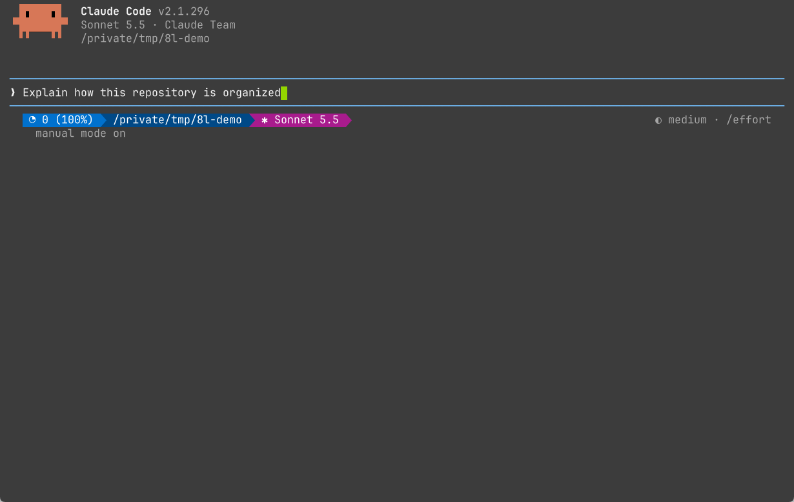</a><br>Dark Gray | <a href="screenshots/claude/8th-light-mid-gray.png">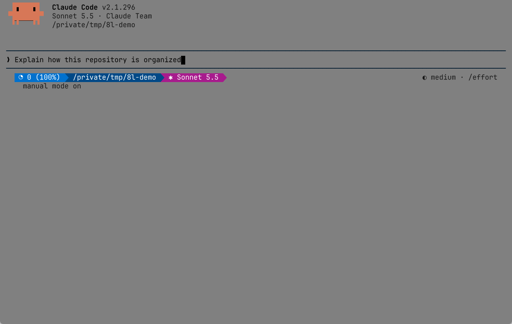</a><br>Mid Gray |
| <a href="screenshots/claude/8th-light-light-gray.png">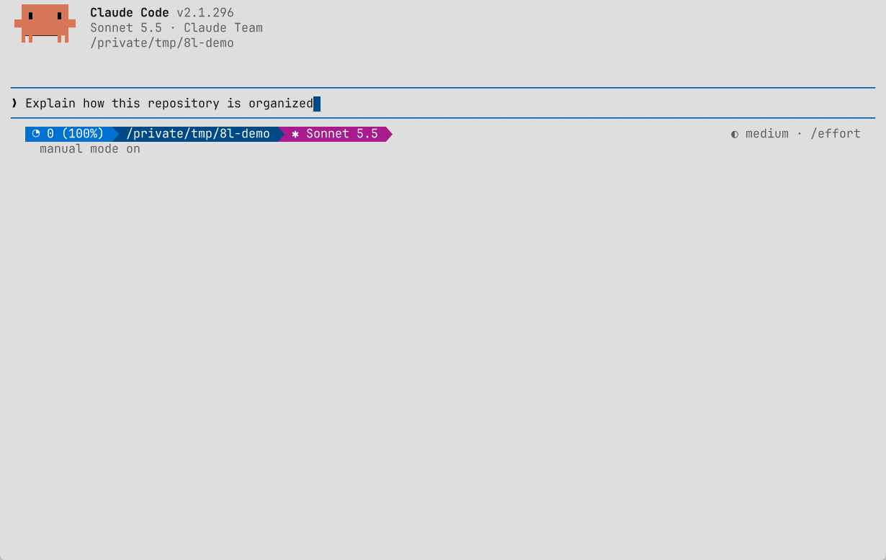</a><br>Light Gray | <a href="screenshots/claude/8th-light-lighter-gray.png">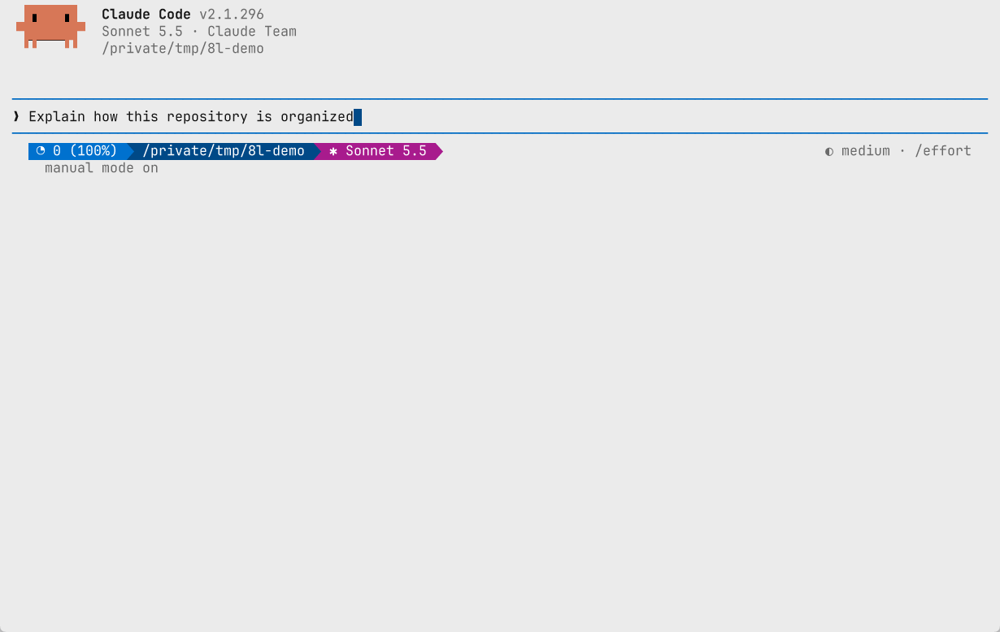</a><br>Lighter Gray | <a href="screenshots/claude/8th-light-lightest-gray.png"></a><br>Lightest Gray | <a href="screenshots/claude/8th-light-white.png">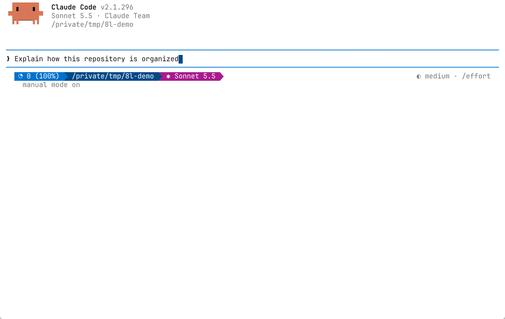</a><br>White |

</details>

<details>
<summary><strong>Codex CLI</strong></summary>

|  |  |  |  |
| --- | --- | --- | --- |
| <a href="screenshots/codex/8th-light-black.png">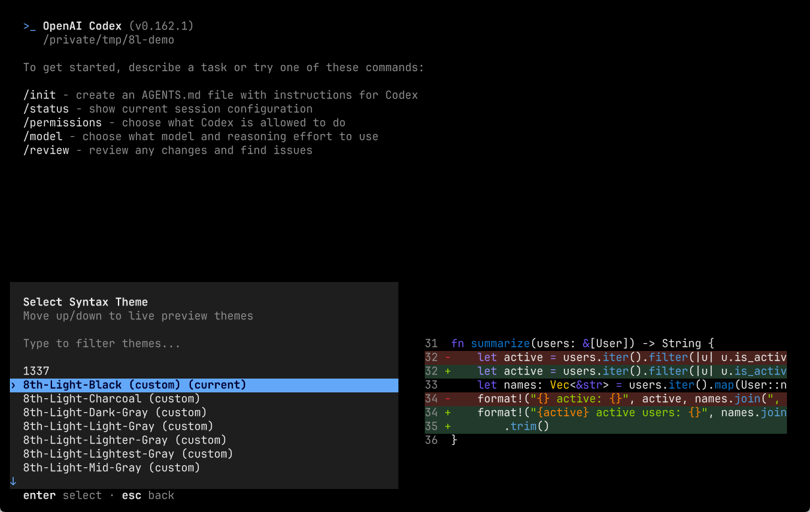</a><br>Black | <a href="screenshots/codex/8th-light-charcoal.png">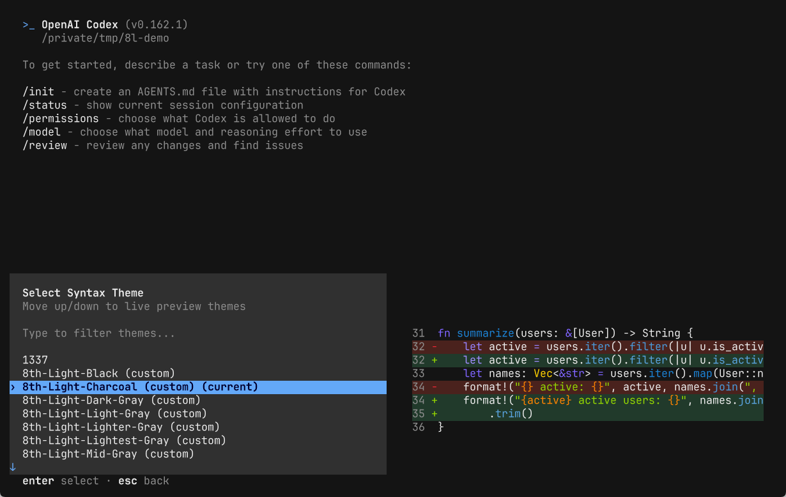</a><br>Charcoal | <a href="screenshots/codex/8th-light-dark-gray.png">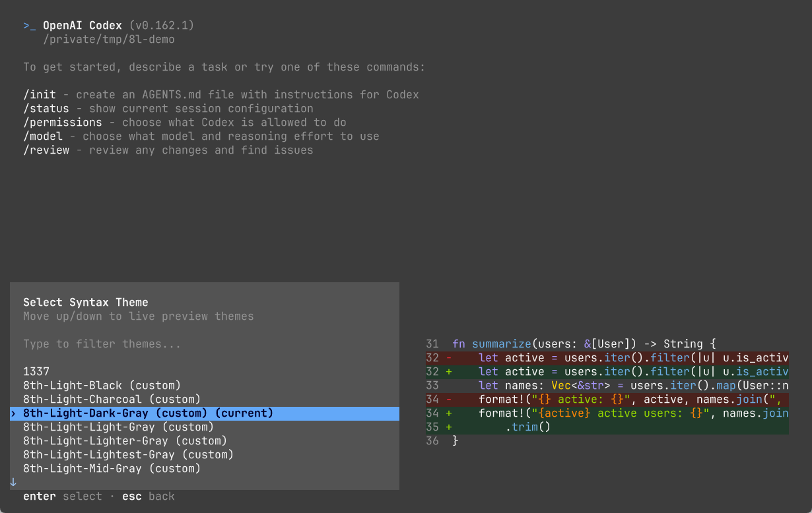</a><br>Dark Gray | <a href="screenshots/codex/8th-light-mid-gray.png">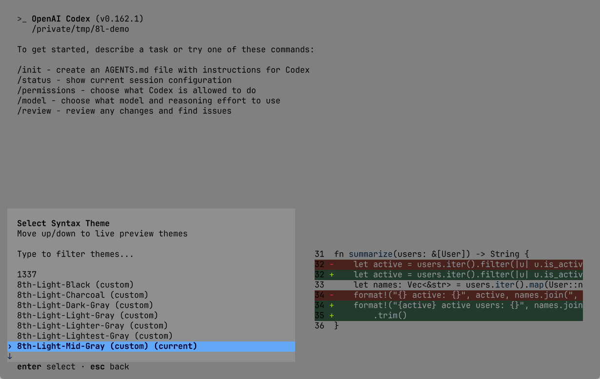</a><br>Mid Gray |
| <a href="screenshots/codex/8th-light-light-gray.png">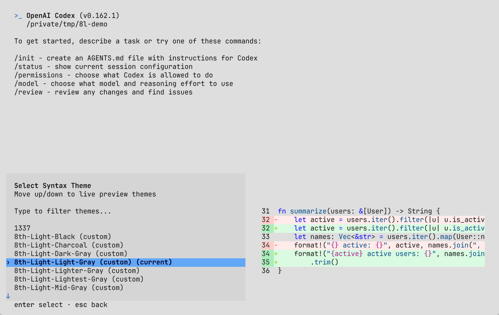</a><br>Light Gray | <a href="screenshots/codex/8th-light-lighter-gray.png">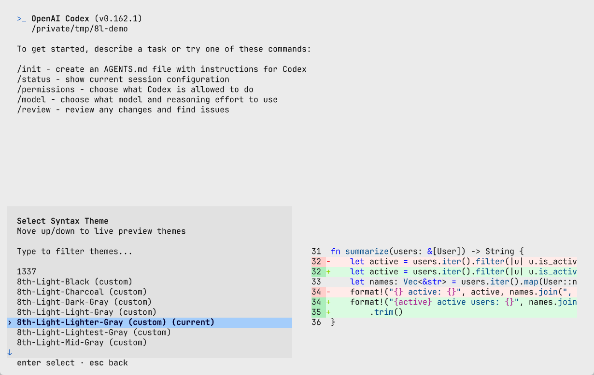</a><br>Lighter Gray | <a href="screenshots/codex/8th-light-lightest-gray.png">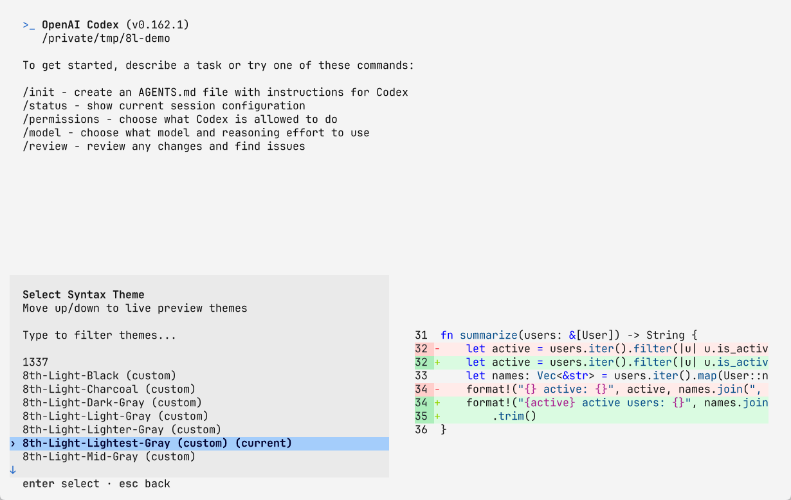</a><br>Lightest Gray | <a href="screenshots/codex/8th-light-white.png">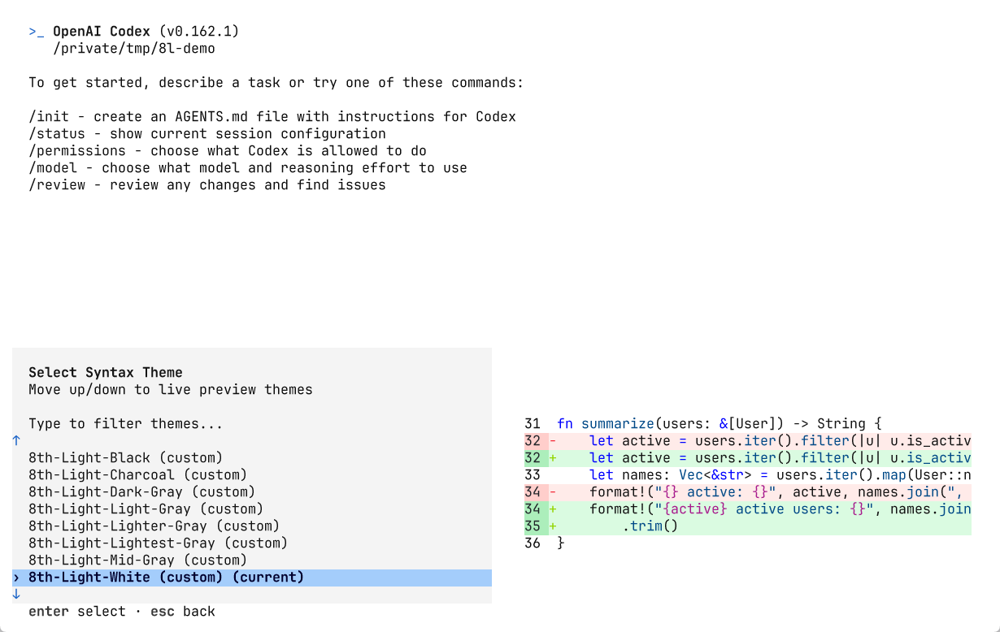</a><br>White |

</details>

## Install

Each application installs on its own, so use only the ones you need.

| Application | Simplest install | Needs a clone |
| --- | --- | --- |
| Kitty | Download one `.conf` file | No |
| Neovim and Neovide | Add the plugin with lazy.nvim | No |
| JetBrains IDEs | Download the plugin from the [latest release](https://github.com/8thlight/8L-themes/releases/latest) | No |
| Claude Code | Download a theme JSON into `~/.claude/themes/` | No |
| Claude Powerline | Download a preset JSON and select it with `--config` | No |
| Codex CLI | Download a `.tmTheme` file into `~/.codex/themes/` | No |
| Codex app | Import a `.codex-theme` share string in Appearance settings | No |

### Kitty

Download the variant you want into Kitty's themes directory:

```sh
theme=8th-Light-Charcoal
mkdir -p ~/.config/kitty/themes
curl -fsSL -o ~/.config/kitty/themes/$theme.conf \
  https://raw.githubusercontent.com/8thlight/8L-themes/main/extras/kitty/$theme.conf
```

Then include it in `~/.config/kitty/kitty.conf`:

```conf
include themes/8th-Light-Charcoal.conf
```

Reload the configuration with <kbd>Ctrl</kbd>+<kbd>Shift</kbd>+<kbd>F5</kbd>
(<kbd>Cmd</kbd>+<kbd>Ctrl</kbd>+<kbd>,</kbd> on macOS), or restart Kitty. The
available names are listed under [Variants](#variants).

### Neovim and Neovide

The repository root is a Neovim plugin. With
[lazy.nvim](https://lazy.folke.io/), add it to your plugin list:

```lua
{ "8thlight/8L-themes" }
```

Then set the theme in `init.lua`:

```lua
vim.cmd.colorscheme("8th-Light-Charcoal")
```

lazy.nvim loads the plugin when `:colorscheme` first needs it. Without a plugin
manager, [install from a clone](#install-from-a-clone) and run `just link-nvim`,
then set the theme in `init.lua` as above.

### JetBrains IDEs

Download `8th-light-themes-<version>.jar` from the
[latest release](https://github.com/8thlight/8L-themes/releases/latest). In the
IDE, open **Settings | Plugins | gear menu | Install Plugin from Disk**, select
the JAR, and restart the IDE. Then select a complete theme under **Settings |
Appearance & Behavior | Appearance**. Each UI theme selects its matching editor
scheme; the schemes can also be chosen independently under **Settings | Editor |
Color Scheme**.

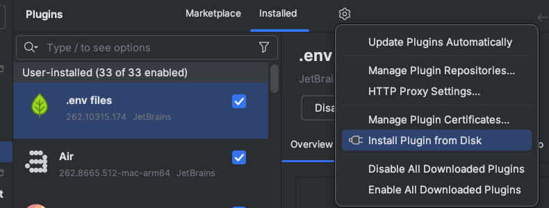

To build the plugin from a [clone](#install-from-a-clone) instead, run:

```sh
nix develop -c just link-jetbrains
```

This links the build into every detected IDE. Without Nix, build the JAR by hand
and install it through **Install Plugin from Disk**. This needs `zip`:

```sh
repository="$PWD"
mkdir -p "$repository/build/jetbrains"
(
  cd extras/jetbrains
  zip -q -FS -r "$repository/build/jetbrains/8th-light-themes.jar" \
    META-INF images schemes themes
)
```

Select `build/jetbrains/8th-light-themes.jar` in the file picker, then restart
the IDE and select a theme as above.

### Claude Code

Download a variant into Claude Code's theme directory:

```sh
theme=8th-Light-Charcoal
mkdir -p ~/.claude/themes
curl -fsSL -o ~/.claude/themes/$theme.json \
  https://raw.githubusercontent.com/8thlight/8L-themes/main/extras/claude/$theme.json
```

Run `/theme` in Claude Code and choose **8th Light Charcoal**. If this is your
first custom theme and the `themes` directory did not exist when Claude started,
restart Claude once. Subsequent edits reload automatically. With a clone, run
`just link-claude` to install all eight variants.

These are native Claude Code interface themes, including accents, input borders,
message surfaces, diffs, usage meters, and subagent colors. Select the matching
Kitty theme for the terminal background; Claude does not set that background.
Custom themes require a Claude Code version with the custom `/theme` picker
(validated with 2.1.296). See the [Claude theme documentation](https://code.claude.com/docs/en/terminal-config#create-a-custom-theme).

### Claude Powerline

The status bar is a separate integration for
[`@owloops/claude-powerline`](https://github.com/Owloops/claude-powerline).
Download the matching preset:

```sh
theme=8th-Light-Charcoal
mkdir -p ~/.claude/powerline/themes
curl -fsSL -o ~/.claude/powerline/themes/$theme.json \
  https://raw.githubusercontent.com/8thlight/8L-themes/main/extras/claude-powerline/$theme.json
```

Merge this entry into `~/.claude/settings.json`, keeping your other settings:

```json
{
  "statusLine": {
    "type": "command",
    "command": "npx -y @owloops/claude-powerline@latest --style=powerline --theme=custom --config=\"$HOME/.claude/powerline/themes/8th-Light-Charcoal.json\""
  }
}
```

With a clone, `just link-claude-powerline` installs all eight presets. The
explicit `--config` selects the preset even in projects that have their own
Powerline configuration. The presets use truecolor, cover all 19 color roles,
and retain Powerline's default segments and behavior. To keep custom segment or
budget settings, merge the preset's `theme`, `colors`, and color/style display
keys into your existing Powerline config and point `--config` at that file.
Validated with Claude Powerline 1.32.5.

### Codex CLI

Download a TextMate theme into Codex's theme directory:

```sh
theme=8th-Light-Charcoal
mkdir -p "${CODEX_HOME:-$HOME/.codex}/themes"
curl -fsSL -o "${CODEX_HOME:-$HOME/.codex}/themes/$theme.tmTheme" \
  https://raw.githubusercontent.com/8thlight/8L-themes/main/extras/codex-cli/$theme.tmTheme
```

Run `/theme` in Codex and select **8th-Light-Charcoal (custom)**. Codex saves the selection
as `theme = "8th-Light-Charcoal"` in the `[tui]` section of its `config.toml`.
With a clone, run `just link-codex-cli` to install all eight variants.

These themes color syntax in code blocks and diffs. The surrounding interface
uses the terminal's colors, so select the matching Kitty theme as well.
Validated with Codex CLI 0.162.1. See the
[Codex CLI theme documentation](https://learn.chatgpt.com/docs/cli-customization#syntax-highlighting-and-themes).

### Codex app

Each variant includes a share string in
[`extras/codex-app/`](extras/codex-app/) with the `.codex-theme` extension.
Download one and copy its entire contents, starting with `codex-theme-v1:`:

```sh
curl -fsSL https://raw.githubusercontent.com/8thlight/8L-themes/main/extras/codex-app/8th-Light-Charcoal.codex-theme
```

In **Settings | Appearance**, choose **Import** in the matching dark or light
theme section and paste the string. Black, Charcoal, and Dark Gray are dark
themes; the other five variants are light themes. On macOS, from a clone:

```sh
just codex-app-theme Charcoal | pbcopy
```

The adjacent `.json` files contain the readable import payload. App themes
configure the background, text, accent, semantic colors, contrast, and opaque
windows. The app importer accepts built-in syntax presets only, so these imports
use the Codex syntax preset; custom CLI `.tmTheme` files cannot be imported into
the app. Fonts use the app defaults. See the
[app appearance documentation](https://learn.chatgpt.com/docs/reference/settings#appearance).

### Install from a clone

Clone the repository and keep it in a stable location. The helper commands
create symlinks back to the checkout.

```sh
git clone https://github.com/8thlight/8L-themes.git
cd 8L-themes
```

The helpers need macOS or Linux with Bash and [`just`](https://just.systems/).
With [Nix](https://nixos.org/download/) and flakes enabled, the development
shell supplies `just`, `zip`, and the tools `just check` uses. With
[direnv](https://direnv.net/) and its Nix integration, approve the environment
once; otherwise prefix each command with `nix develop -c`:

```sh
direnv allow
just link
```

`just link` installs the Kitty, Neovim, JetBrains, Claude Code, Claude Powerline,
and Codex CLI files. JetBrains must have an existing configuration directory.
Use the individual `just link-<application>` recipes if you only need some of
them. The Codex app uses its Appearance importer separately. Run `just --list`
to see all available helper commands. The helpers refuse to replace regular
files. Installing presets does not change your active theme or settings.

Without `just`, link the files by hand. For Kitty:

```sh
kitty_themes="${KITTY_CONFIG_DIRECTORY:-${XDG_CONFIG_HOME:-$HOME/.config}/kitty}/themes"
mkdir -p "$kitty_themes"
ln -s "$PWD"/extras/kitty/*.conf "$kitty_themes/"
```

For Neovim and Neovide:

```sh
nvim_packages="${NVIM_DATA_DIRECTORY:-${XDG_DATA_HOME:-$HOME/.local/share}/nvim}/site/pack/8th-light/start"
mkdir -p "$nvim_packages"
ln -s "$PWD" "$nvim_packages/8th-light.nvim"
```

The direct `ln` commands intentionally fail when a destination already exists
rather than replacing it.

By default, the JetBrains installer detects IDE configuration directories under
`~/Library/Application Support/JetBrains` on macOS and either
`$XDG_CONFIG_HOME/JetBrains` or `~/.config/JetBrains` on Linux. Set
`JETBRAINS_CONFIG_DIRECTORY` to install into one specific configuration
directory instead. The other helpers honor `KITTY_CONFIG_DIRECTORY`,
`NVIM_DATA_DIRECTORY`, `XDG_CONFIG_HOME`, and `XDG_DATA_HOME` where applicable.
The agent helpers honor `CLAUDE_CONFIG_DIR` and `CODEX_HOME`.

### Update and uninstall

| Installed by | Update | Uninstall |
| --- | --- | --- |
| Kitty download | Download the file again | Delete the file and the `include` line |
| lazy.nvim | `:Lazy update` | Remove the plugin spec |
| JetBrains release | Install the newer JAR over the old one | Uninstall it under **Settings \| Plugins** |
| Clone and helpers | `git pull`, then `just link` | `just unlink` |
| Claude or Codex CLI download | Download the file again | Select another theme, then delete the file |
| Claude Powerline preset | Download the file again | Change the status command, then delete the preset |
| Codex app import | Import the updated share string | Select another appearance preset or restore your colors |

Kitty and Neovim installs from a clone update through their symlinks, so
`git pull` is enough for them. JetBrains needs `just link-jetbrains` again to
rebuild the plugin, and the IDE needs a restart. Run `just unlink` before
moving or deleting the checkout. It removes only symlinks that point into this
checkout.

Before `just unlink`, select another Claude/Codex CLI theme and remove or change
any Powerline command that points at these presets. The unlink helpers remove
only links belonging to this checkout; they do not edit your settings or undo a
Codex app import.

## Variants

Eight neutral-background variants are available in every application:

| Variant | Kitty and Neovim name | JetBrains name |
| --- | --- | --- |
| Black | `8th-Light-Black` | 8th Light Black |
| Charcoal | `8th-Light-Charcoal` | 8th Light Charcoal |
| Dark Gray | `8th-Light-Dark-Gray` | 8th Light Dark Gray |
| Mid Gray | `8th-Light-Mid-Gray` | 8th Light Mid Gray |
| Light Gray | `8th-Light-Light-Gray` | 8th Light Light Gray |
| Lighter Gray | `8th-Light-Lighter-Gray` | 8th Light Lighter Gray |
| Lightest Gray | `8th-Light-Lightest-Gray` | 8th Light Lightest Gray |
| White | `8th-Light-White` | 8th Light White |

## Notes

### Agent themes

The four agent integrations use the existing Neovim palette and variant roles
as their source. To regenerate the checked-in files after changing that palette:

```sh
just generate-agent-themes
```

Brand colors are preserved where they provide sufficient text contrast.
Foreground accents are shaded toward black or white when necessary to reach
4.5:1 contrast on the relevant background. Claude diffs use tinted backgrounds
to keep the foreground readable. Mid Gray follows the restrained light syntax
mapping used by the Neovim variant. No theme chooses a font.

### Neovim colorscheme

The colorscheme sets Neovim UI, syntax, Tree-sitter, diagnostics, diffs, Git
signs, embedded terminal colors, and Neovide's background and cursor-effect
colors.

### JetBrains plugin

The resource-only plugin in [`extras/jetbrains/`](extras/jetbrains/) provides
complete UI themes and matching editor schemes in RustRover, IntelliJ IDEA,
WebStorm, PyCharm, and other JetBrains IDEs. The UI themes cover application
controls, tabs, tool windows, menus, and branded background artwork. The editor
schemes cover shared editor colors, language-default syntax, console and diff
output, diagnostics, and Rust semantic highlighting.

The plugin targets JetBrains Platform 2025.1 (`since-build 251`) and newer.

Fonts and behavioral preferences such as folding, formatting, and title-bar
paths remain IDE settings and are deliberately not changed by a theme.

The empty editor uses a fixed-size, bottom-centered 8th Light lockup on a
transparent canvas. It is naturally clipped in narrow panes and revealed in
wide panes without painting behind ordinary editors, tool windows, or IDE
chrome. Dark and light themes use white and charcoal lockups respectively.

### Agent screenshots

The Claude Code and Codex CLI images come from the real programs, run in a
terminal emulator whose colors are read from the matching Kitty theme. Codex
shows its syntax theme picker with a live preview. Claude shows its main prompt
and Powerline preset. On macOS, with Go and a logged-in `claude` and `codex`:

```sh
just agent-screenshots
```

The recipe runs both programs in `/tmp/8l-demo` and writes
`screenshots/claude/` and `screenshots/codex/`. The first run accepts Claude's
trust prompt for that folder, which Claude records in `~/.claude.json`. The
images show the installed program versions, so review them before committing.
The Claude Code image also shows a startup tip that changes between runs.

## Palette

The neutral base is used for the terminal background, foreground, borders, and
tabs. The 8thlight.com website's spectrum names determine the ANSI mapping: dark blue is
ANSI blue, PMS 285 blue is ANSI cyan, purple is ANSI magenta, and violet is
bright magenta. The website's blue-255 is used for bright blue.

| Role | Hex | RGB |
| --- | --- | --- |
| True black | `#000000` | `0, 0, 0` |
| Charcoal | `#141414` | `20, 20, 20` |
| Dark gray | `#3C3C3C` | `60, 60, 60` |
| Mid gray | `#808080` | `128, 128, 128` |
| Website gray 350 | `#A6A6A6` | `166, 166, 166` |
| Light gray | `#DEDEDE` | `222, 222, 222` |
| Lighter gray | `#EBEBEB` | `235, 235, 235` |
| Lightest gray | `#F4F4F4` | `244, 244, 244` |
| White | `#FFFFFF` | `255, 255, 255` |
| Red (PMS 1788) | `#F32735` | `243, 39, 53` |
| Orange (PMS 151) | `#FF8300` | `255, 131, 0` |
| Yellow (PMS 109) | `#FFD100` | `255, 209, 0` |
| Green (PMS 375) | `#93D500` | `147, 213, 0` |
| Blue (PMS 285) / website cyan | `#0071CE` | `0, 113, 206` |
| Dark blue (PMS 301) / website blue | `#004987` | `0, 73, 135` |
| Purple (PMS 248) / website indigo | `#A81B8D` | `168, 27, 141` |
| Website violet | `#5938FF` | `89, 56, 255` |
| Website blue-255 | `#0000FF` | `0, 0, 255` |

## Layout

- [`colors/`](colors/) and [`lua/`](lua/): the Neovim plugin.
- [`extras/kitty/`](extras/kitty/): Kitty themes.
- [`extras/jetbrains/`](extras/jetbrains/): the JetBrains theme plugin.
- [`extras/claude/`](extras/claude/): native Claude Code interface themes.
- [`extras/claude-powerline/`](extras/claude-powerline/): Claude Powerline presets.
- [`extras/codex-cli/`](extras/codex-cli/): TextMate themes for Codex CLI.
- [`extras/codex-app/`](extras/codex-app/): Codex app import payloads and share strings.
- [`scripts/`](scripts/): agent theme generation, validation, safe linking, and agent screenshots.
- [`docs/`](docs/) and [`screenshots/`](screenshots/): the palette, logo, and
  install images, and the theme screenshots shown above.

## Development

```sh
nix develop -c just check
```

The check validates XML, JSON, and Lua syntax, confirms every variant exists in
each application and in the screenshots, verifies the JetBrains theme
references, compares Kitty keys across variants, and matches the README palette
against the Neovim palette.
It also checks that generated agent themes are current, validates their consumer
formats and text contrast, and exercises installation/uninstallation with user
files, foreign symlinks, and paths containing spaces.

### Releasing

Tag a commit on `main` with a version such as `v0.1.0` and push the tag. The
release workflow runs the checks, builds the JetBrains plugin JAR with that
version, and attaches it to a GitHub release.

## License

Copyright © 2026 8th Light, LLC. Licensed under the MIT License. See [LICENSE](LICENSE).

8th Light® and the 8th Light logo are trademarks of 8th Light, LLC and are not covered by the MIT License.

<a href="https://8thlight.com"></a>
